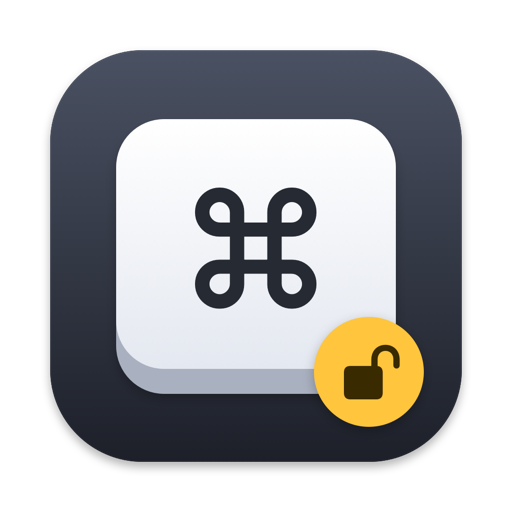

# Keybinds Unlocked

Keybinds macOS doesn't offer, like double-tap ⌘ for Mission Control or a mouse side button for Show Desktop.

https://traes008.github.io/keybinds-unlocked/

- Triggers: double tap of a modifier key, a mouse button, or a key shortcut.
- Actions: Mission Control, Application Windows, Show Desktop.
- Add as many as you want.

## Install

No download yet. Build it in Xcode:

1. Open `KeybindsUnlocked.xcodeproj`.
2. Under Signing & Capabilities, pick your own team (a free Apple account works).
3. Run, then move the app to Applications.
4. Allow it under Privacy & Security → Accessibility.

No menu bar icon. Open the app again for its settings.

## Notes

- A bound mouse button is taken over, so other apps don't see it.
- `scripts/check.sh` runs the logic tests. Start reading at `KeybindsUnlocked/Trigger.swift`.

MIT licence.
